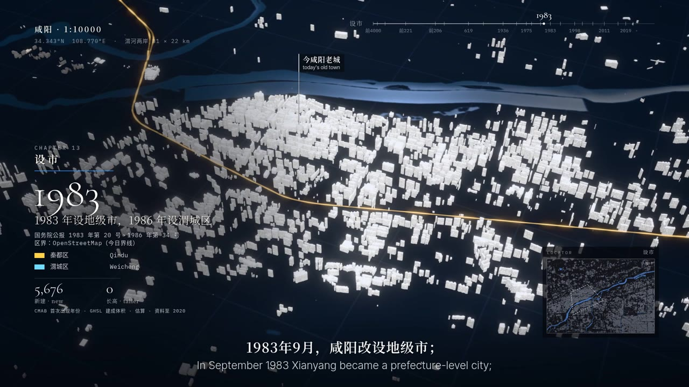

# 一城春秋 · A City Through Time

Give it a city and a starting era. A coding agent researches the sources, pulls building and map data, and builds the whole city as a white model. It lights the city up era by era, from the earliest settlement to today, and renders the result as a bilingual film.

**Entry page: [cities.go5.si](https://cities.go5.si/)**. Turn the globe, pick a lit-up city to watch, or make a film of your own city.

**Project introduction video**: [English](https://www.youtube.com/watch?v=ZeqlfaAadHg) · [中文](https://www.youtube.com/watch?v=CbMU4t607tc)

English · [繁體中文](README.zh-Hant.md) · [简体中文](README.zh-Hans.md)



## Cities so far

| City | Years | Length | Narration | Author |
|---|---|---|---|---|
| [Xianyang](https://cities.go5.si/xianyang/) | 4000 BCE – 2026 | 12 min 30 s | Chinese | Alex |
| [Rome](https://cities.go5.si/rome/) | 753 BCE – 2026 | 30 min 8 s | English | Alex |

Each city's data lives in `cities/<city>/`: `entry.json` for the entry page, the config and script, `FACTS.md` (sources for every historical fact), and `CREDITS` (third-party material and licences). The city index `cities.json` that the entry page reads, and each city's own page in five languages (for example [cities.go5.si/xianyang/](https://cities.go5.si/xianyang/)), are generated automatically by GitHub Actions from each city's `entry.json`. The repository holds text data only; finished films, web bundles and posters are kept elsewhere. The example city, Xianyang, is the exception: it keeps its images, poster and web bundle, and the entry page plays it straight from here.

## How a film is made

[Claude Code](https://claude.com/claude-code) (or another agent that reads skills) makes the film, following the rules in [`AGENTS.md`](AGENTS.md) step by step. A person sets the direction and checks every step in the browser.

1. **Research**: build a timeline of the city, with the source and original text for every fact, written into `FACTS.md`.
2. **Data**: today's buildings (CMAB in China, Overture Maps plus GHSL years elsewhere), OpenStreetMap water and roads, and Copernicus terrain and satellite imagery.
3. **Past cities**: generate the city of each era by code, from archaeological reports and historical sources (schematic models, not reconstructions), marked "schematic" on screen.
4. **Timeline and script**: the narration is one continuous story and the picture follows its sentences. Every stop is a turning point of that particular city.
5. **Preview**: play it live in the browser and revise it section by section.
6. **Narration, music and sound effects**: first ask the author which way to go (a recording, an online service, a local model, or code-written music as a model-free fallback).
7. **Render and delivery**: the finished film, bilingual subtitles, cover and description. No tool metadata is written when the film is assembled.

For every city, a fixed set of checks is run: model clipping, camera clipping, subtitle width, how long text stays on screen, picture jumps, black frames and loudness.

## Make one yourself

You need Claude Code (or another agent that reads skills), Node 20 or later, [uv](https://docs.astral.sh/uv/), ffmpeg, exiftool, git, and a computer with a graphics card and Chrome installed.

**Recommended: install the skill.** ([city-through-time-skill](https://github.com/alexliyu7352/city-through-time-skill))

```sh
npx skills add alexliyu7352/city-through-time-skill -g -y
```

Run it in a terminal: it installs the skill for every agent it finds on this computer (Claude Code, Codex, Cursor, Gemini CLI and others) and into the shared `~/.agents/skills`. Run from inside an agent, it installs for that agent alone.

or, in Claude Code, `/plugin marketplace add alexliyu7352/city-through-time-skill`, then `/plugin install city-through-time@city-through-time`.

Then tell the agent: "Use A City Through Time to make <city>, starting from <era>." The first time, it asks where to put the workspace (this repository) and clones it there, asks where on this computer to keep data and models (by default everything goes under `local/` in the workspace), then sets up the environment. You do not clone anything yourself.

**Or clone it yourself and link it as a skill.** For working on the project's code, or keeping the workspace where you like:

```sh
git clone https://github.com/alexliyu7352/city-through-time.git
ln -s "$PWD/city-through-time/skill/skills/city-through-time" ~/.claude/skills/city-through-time   # Claude Code; for other agents, their own skills folder (for example ~/.agents/skills)
```

Then open the agent inside `city-through-time` and say the same sentence: the skill finds the workspace it is in and goes on from there. To send your city back to this site, fork the repository first and clone your fork.

Full guide: [`docs/MAKING.md`](docs/MAKING.md).

## Add your city to the entry page

1. Put the finished film on YouTube, Bilibili or another video site.
2. To let people play it straight from the entry page, put the web bundle (packed with `tools/web.py`) on a Hugging Face dataset or your own GitHub Pages.
3. Open a pull request with only the text files in the city folder, including `entry.json` for the entry page.

You can also give your city a site of its own: with a free Cloudflare account, `node tools/deploy.mjs --city <city>` publishes it (its page, the 3D player, the walk through the old city, the museum pages and the web bundle) at `https://<city>.pages.dev/` in one command. It publishes your city alone, not the whole entry page.

Steps, fields and review criteria: [`CONTRIBUTING.md`](CONTRIBUTING.md).

## Project structure

```
index.html, site/   entry page (reads cities.json; tools/site.mjs generates the language versions and city pages)
play.html, engine/  player (three.js): white model, projection, subtitles, end credits
pipeline/           data and compilation: fetch data, generate past cities, lay out the timeline
render/             rendering: stills, video, assembling the finished film
audio/              sound: laying music, code-written music, mixing
tools/              one-command film build, preview, checks, web bundle, music generation
cities/<city>/      each city's source data (config, script, fact sources, research, assets)
templates/, i18n/   templates for new cities; the text shown on screen (six languages)
types/              shared house types of past periods, one file per type
fonts/              open-source fonts (SIL OFL)
```

## Licence

- Code: [MIT, with an attribution condition](LICENSE). Use, change and share it freely; once you show others a film, picture or online preview made with it, credit the project on the work: "一城春秋 · A City Through Time" and the address of the project's site (cities.go5.si) or its repository on screen (the end card draws the site's by default; do not remove or cover it), "Made with 一城春秋 · A City Through Time" and a link to the repository wherever the work is published, and a visible link to the repository on a page that plays it (the built-in player has one). Private use carries no such duty. Versions published up to 2026-10-24 (`d0bd33d`) remain under the plain MIT licence. Some code is adapted from [lemo-opuscar](https://github.com/lemomo-ai/lemo-opuscar) (MIT, the origin of the white-model projection style); the list is in [`NOTICE`](NOTICE).
- Bring your city back to this repository: cities submitted here appear on the entry page (see [`CONTRIBUTING`](CONTRIBUTING.md)).
- Films and city data: [CC BY-SA 4.0](LICENSE-CONTENT.md). The films use CC BY-SA live-action footage, so under that licence the finished film must also be CC BY-SA.
- Material by others follows its own licence, listed in each city's `CREDITS`: building and map data (CC BY 4.0, ODbL), live-action footage and photos from Wikimedia Commons, and fonts (OFL).
- The globe on the entry page is drawn from [Natural Earth](https://www.naturalearthdata.com/) and NOAA ETOPO1 (both public domain).

## About AI

The coding agent does the research, the code and the rendering. The narration, music and imagined scenes in the films are AI-generated, and are labelled on screen and in the end credits. Every historical fact must have a source you can find in `FACTS.md`, and schematic or estimated pictures are marked as such on screen.
