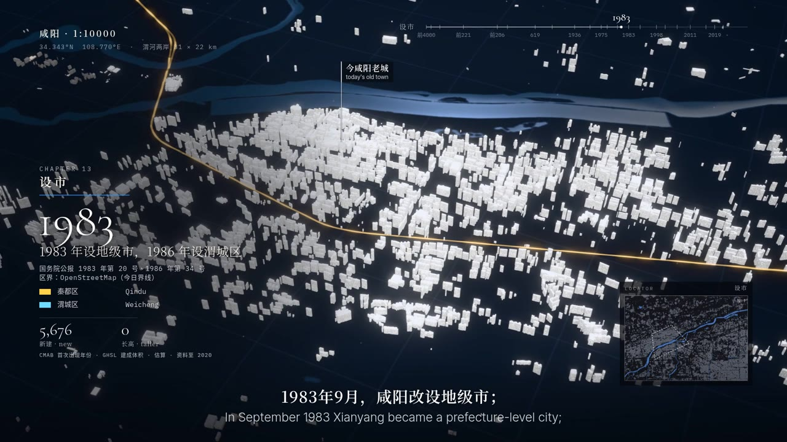

# 一城春秋 · A City Through Time

给一座城市和一个起始年代，编程代理会查史料、抓建筑与地图数据，把整座城做成白色模型，从最早的聚落到今天，一个时代一个时代地点亮，最后渲染成一部双语视频。

**入口页：[cities.go5.si](https://cities.go5.si/)**：转动地球、挑一座亮着的城市观看，或者做一部你自己城市的片。

[English](README.md) · [繁體中文](README.zh-Hant.md) · 简体中文



## 已经有的城市

| 城市 | 年代 | 片长 | 作者 |
|---|---|---|---|
| 咸阳 | 前 4000 年 – 2026 年 | 12 分 30 秒 | Alex |

每座城的数据在 `cities/<城市>/`：入口页用的 `entry.json`、配置和文案、史实出处 `FACTS.md`、第三方素材与许可 `CREDITS`。入口页读的城市索引 `cities.json`，和每座城五种语言的独立页面（例如 [cities.go5.si/xianyang/](https://cities.go5.si/xianyang/)），都由 GitHub Actions 从各城的 `entry.json` 自动生成。仓库里只放文本数据，成片、播放包和海报都放在外部；示例城市咸阳例外，保留了图片、海报和网页播放包，入口页直接从这里播放。

## 片子怎么做出来

做片的是 [Claude Code](https://claude.com/claude-code)，照 [`SKILL.md`](SKILL.md) 这份技能说明一步步做；人负责定方向，并在浏览器里检查每一步。

1. **研究**：建立这座城的年代表，每条史实都附出处和原文，写进 `FACTS.md`。
2. **数据**：今天的建筑（中国用 CMAB，其他地方用 Overture Maps 加 GHSL 年份）、OpenStreetMap 的水系和路网、Copernicus 地形和卫星影像。
3. **历代城市**：按考古报告和史料，用程序生成各时代的城（示意模型，不是复原），画面上标“示意”。
4. **时间轴与文案**：旁白是一条连贯的叙事，画面跟着句子走；每一站都是这座城自己的转折。
5. **预览**：浏览器里实时播放，逐段修改。
6. **旁白、配乐、音效**：先问作者用哪种方式（录音、在线服务、本地模型；或是程序写的配乐，当作不用模型的备用选项）。
7. **渲染与交付**：成片、双语字幕、封面、简介；合成时不写任何工具的元数据。

做每座城时都会照固定的检查跑一遍：模型穿模、镜头穿模、字幕宽度、文字停留时间、画面跳动、黑帧和响度。

## 自己做一部

要准备：Claude Code、Node 20 以上、[uv](https://docs.astral.sh/uv/)、ffmpeg、exiftool，以及一台有显卡、装了 Chrome 的电脑。

```sh
git clone https://github.com/alexliyu7352/city-through-time.git
ln -s "$PWD/city-through-time" ~/.claude/skills/city-through-time   # 让 Claude Code 认得这个技能
```

然后在 Claude Code 里说：“用一城春秋做〇〇，从〇〇时代开始”。第一次使用时，它会先问你这台电脑要把数据、模型放在哪里（默认全部放在项目的 `local/` 下），再装好环境。

完整教程：[`docs/MAKING.zh-Hans.md`](docs/MAKING.zh-Hans.md)。

## 把你的城市加到入口页

1. 成片放到 YouTube、B 站或其他视频网站。
2. 想让大家在入口页直接播放，就把网页播放包（`tools/web.py` 打包）放到 Hugging Face 数据集，或你自己的 GitHub Pages。
3. 开一个 pull request：只放城市文件夹里的文本文件，包括入口页用的 `entry.json`。

步骤、字段和审核标准：[`CONTRIBUTING.zh-Hans.md`](CONTRIBUTING.zh-Hans.md)。

## 项目结构

```
index.html, site/   入口页（读 cities.json；tools/site.mjs 生成各语言版本和城市页）
play.html, engine/  播放器（three.js）：白模、投影、字幕、片尾
pipeline/           数据与编译：抓数据、生成历代城市、排时间轴
render/             渲染：单张、视频、合成成片
audio/              声音：铺配乐、程序配乐、混音
tools/              一条命令出片、预览、各项检查、网页播放包、配乐生成
cities/<城市>/       每座城的原始数据（配置、文案、史实出处、研究、素材）
templates/, i18n/   新城市模板；画面上的字（六种语言）
types/              历代房屋类型的共用库，一种一个文件
fonts/              开源字体（SIL OFL）
```

## 许可

- 代码：[MIT](LICENSE)。部分程序改自 [lemo-opuscar](https://github.com/lemomo-ai/lemo-opuscar)（MIT，白模投影风格的出处），清单在 [`NOTICE`](NOTICE)。
- 视频与城市数据：[CC BY-SA 4.0](LICENSE-CONTENT.md)。因为片中用了 CC BY-SA 的实拍，依许可规定成片本身也必须是 CC BY-SA。
- 他人的素材依各自许可，列在每座城的 `CREDITS`：建筑与地图数据（CC BY 4.0、ODbL）、Wikimedia Commons 的实拍与照片、字体（OFL）。
- 入口页的地球依 [Natural Earth](https://www.naturalearthdata.com/) 与 NOAA ETOPO1（均为公有领域）绘制。

## 关于 AI

研究、编程、渲染都由编程代理完成。片中的旁白、配乐和想象图是 AI 生成的，画面和片尾都有标注；每一条史实都要在 `FACTS.md` 找得到出处，示意与估算的画面上会写明。
